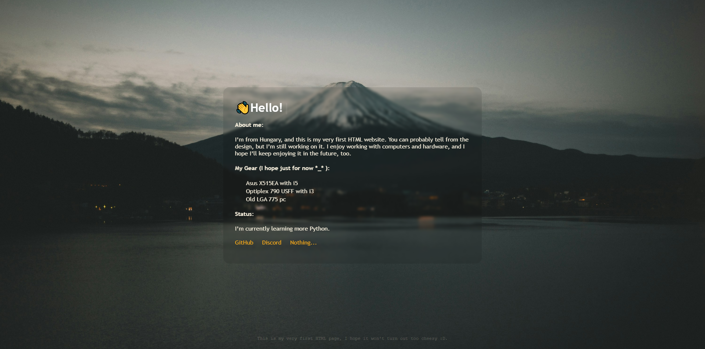

#About Me page

A small personal website built as my first public HTML and CSS project. I’ve always wanted to create and publish a small personal website to introduce myself. 

Live demo: [Live demo](https://about-me.dunibeni09.workers.dev/)

Built with:
  - HTML
  - CSS
  - Typed JS | https://github.com/mattboldt/typed.js/
  - Cloudflare workers for Web Hosting
    
How to Run Locally:
  1. Clone or download this repository.
  2. Open index.html in your web browser. (An internet connection is required for Typed.js to load from its CDN.)

AI usage: I used AI for better english translation

